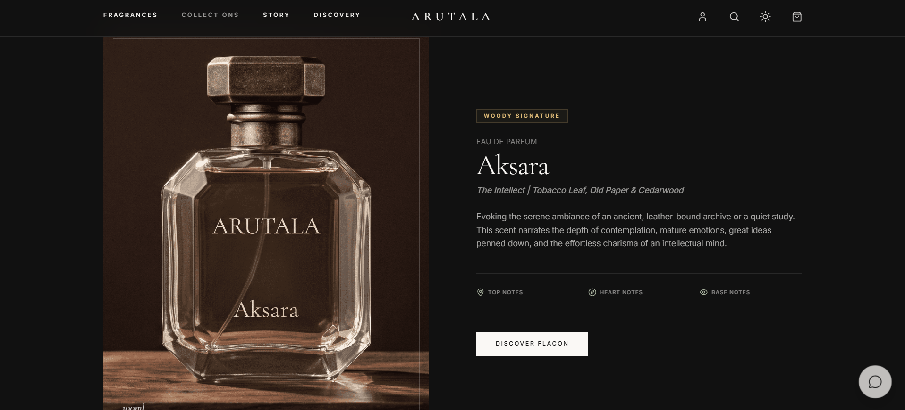
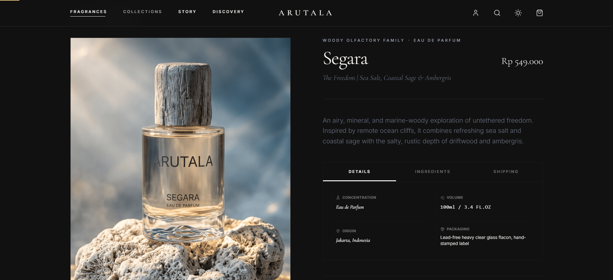
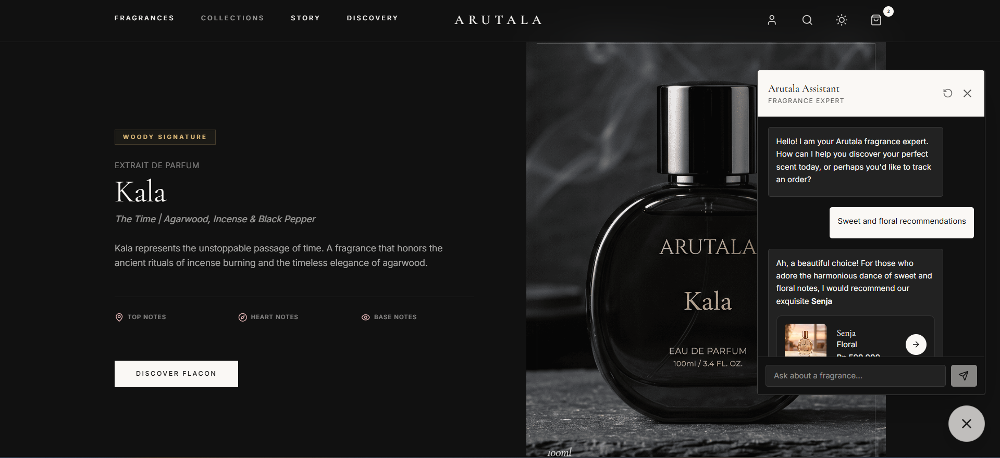
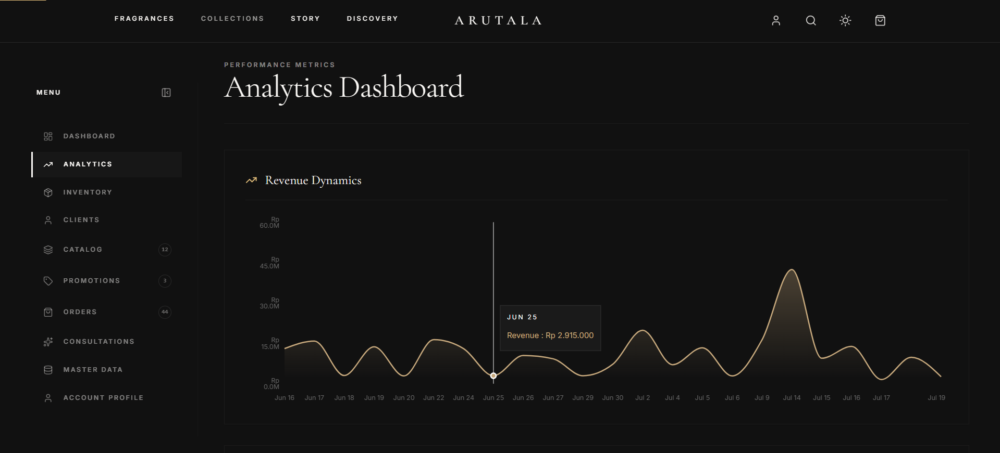

  
  
  # 🌙 Arutala - Premium Local Perfumery 
  ### *A Full-Stack E-Commerce Masterpiece*

  
  
  
  
  
  
  
  
  
  
  
  
  Arutala (meaning "Moon" or "Light" in Sanskrit) is a conceptual Direct-to-Consumer (D2C) premium local perfumery brand. This project serves as a **flagship portfolio piece** demonstrating my ability to design, architect, and develop a holistic, enterprise-grade digital experience that embodies luxury, elegance, and profound storytelling, paired with cutting-edge Artificial Intelligence.

  ---
  
  **Looking for a top-tier developer to build your next web application?**  
  👉 **[Connect & Collaborate](#-work-with-me--contact)** 👈 | 📄 **[Read Full PRD Document](./PRD.md)**

---

## 📑 Table of Contents
1. [Product Requirements Document (PRD)](./PRD.md)
2. [Project Overview & Business Vision](#-project-overview--business-vision)
3. [Platform Highlights (Gallery)](#-platform-highlights)
4. [Deep Dive: Key Features](#-deep-dive-key-features)
5. [Generative AI Integration](#-generative-ai-integration)
6. [Technical Architecture & Stack](#%EF%B8%8F-technical-architecture--stack)
7. [Database Schema](#-database-design)
8. [Security & Performance](#-security--performance)
9. [Work With Me & Contact](#-work-with-me--contact)

---

## 💼 Project Overview & Business Vision

Arutala was built with a single goal: to prove that an e-commerce platform can be both a highly performant sales engine and a beautiful, immersive digital boutique. Purchasing fragrance online is notoriously difficult; Arutala solves this using visual storytelling and an AI-driven concierge.

**Unique Selling Propositions (USP) of this platform:**
- **Story-Driven Commerce**: The UI/UX is designed to sell the *story* of the perfume, utilizing a clean, minimalist "dark-mode luxury" theme that replicates stepping into an exclusive, high-end boutique.
- **AI Concierge ("Find My Scent")**: A seamlessly integrated Google Gemini AI chatbot that interviews the customer, understands their olfactory preferences, and recommends the perfect product.
- **Frictionless Buyer Journey**: Meticulously optimized user flows from catalog exploration to checkout, engineered specifically to reduce cart abandonment rates.
- **Scalable Foundation**: Built on a decoupled microservices architecture (Frontend, Backend API, Bot API), ensuring the platform can scale to handle high traffic spikes.

---

## 📸 Platform Highlights

  <table>
    <tr>
      <td align="center"><b>Storefront / Hero Section</b> </td>
      <td align="center"><b>Immersive Product Details</b> </td>
    </tr>
    <tr>
      <td align="center"><b>AI Chatbot Concierge</b> </td>
      <td align="center"><b>Admin Analytics Dashboard</b> </td>
    </tr>
  </table>

---

## 🛍️ Deep Dive: Key Features

This platform is not just a template; it's a custom-engineered solution equipped with features designed to solve real business challenges.

### 👤 Customer Facing Features (Storefront)
- **Advanced Olfactory Filtering**: Customers can filter fragrances by scent notes (e.g., Woody, Floral, Citrus), intensity, and occasion.
- **Dynamic Scent Pyramid**: Visual representation of Top, Heart, and Base notes for every fragrance to educate the buyer.
- **Cinematic Snap-Scrolling**: A bespoke vertical scrolling experience for product discovery, mimicking high-end fashion magazines.
- **Frictionless Cart & State Management**: Persistent cart state utilizing React Context, ensuring users never lose their selected items.
- **Secure Authentication**: JWT-based login, registration, and password recovery, with a dedicated User Dashboard to track order history.
- **Automated Shipping Calculation**: Integration with third-party logistics APIs to fetch real-time shipping rates across regions based on weight and distance.
- **Instant Payment Gateway**: Webhook-integrated payments supporting Credit Cards, Virtual Accounts, and e-Wallets for instant automated verification.

### 🛡️ Admin Facing Features (Backoffice)
- **Centralized Dashboard**: Real-time overview of total revenue, active orders, and top-selling products.
- **Order Management System (OMS)**: Admins can update order statuses (Processing, Shipped, Delivered), trigger automated customer emails, and input tracking numbers.
- **Dynamic Catalog Management**: Full CRUD (Create, Read, Update, Delete) capabilities for products, including uploading images, managing stock levels, and updating pricing.

---

## 🤖 Generative AI Integration

To bridge the gap of selling scents online, Arutala features a **Generative AI Microservice** powered by **Google Gemini 2.5 Flash**.

- **Strict Persona Adherence**: The bot is prompted to act exactly like a Parisian perfumer—sophisticated, evocative, and deeply knowledgeable about the Arutala catalog.
- **Branching Interview Logic**: Instead of just dumping products, the AI conducts a multi-step interview (e.g., "Do you prefer a lush spring garden or a dark, smoky jazz club?").
- **Automated Function Calling**: The AI natively understands how to call backend Python functions (`search_fragrances`, `get_order_status`) to fetch real-time data from the PostgreSQL database without breaking character.
- **Actionable UI Elements**: The bot streams custom tags that the React frontend intercepts and converts into interactive UI elements (e.g., an "Add to Cart" button rendered inside the chat bubble).

---

## 🛠️ Technical Architecture & Stack

The platform utilizes a modern, decoupled (Headless) microservices architecture. 

### 📁 Service Documentation
For detailed setup and implementation specs of each isolated service:
- 🎨 **[arutala-frontend](./arutala-frontend/README.md)**: React 19 + TypeScript + Vite + Tailwind CSS v4 UI.
- ⚙️ **[arutala-backend](./arutala-backend/README.md)**: Python FastAPI + SQLModel + PostgreSQL REST API.
- 🤖 **[arutala-bot](./arutala-bot/README.md)**: Python FastAPI + Google Gemini 2.5 Flash AI Concierge.

### 🎨 Frontend (Client-Side)
- **Core:** React 19 + TypeScript + Vite (Lightning-fast HMR and optimized builds)
- **Styling:** Tailwind CSS v4 (Utility-first, highly maintainable design system)
- **Animation:** Framer Motion (60fps cinematic page transitions and micro-interactions)
- **Routing:** React Router DOM
- **State Management:** Custom React Hooks + Context API
- **Data Fetching:** Axios / TanStack Query (React Query) for caching and optimistic updates.

### ⚙️ Backend (Server-Side) & API
- **Core Engine:** Python with **FastAPI** (Main Backend) and a dedicated FastAPI service for the AI Bot.
- **Architecture:** Microservices pattern for clean code separation and independent scaling.
- **Authentication:** JWT (JSON Web Tokens) with strict Role-Based Access Control (RBAC).
- **ORM:** SQLModel (combining Pydantic and SQLAlchemy) for type-safe, asynchronous database queries.

---

## 🗄️ Database Design (Schema Deep-Dive)

The database utilizes PostgreSQL, strictly normalized to ensure transactional integrity and optimized for fast read-heavy operations (catalog browsing). 

- **`Users`**: Handles secure authentication and Role-Based Access Control (RBAC). Stores hashed passwords via Bcrypt and defines `ADMIN` vs `USER` permissions.
- **`Products`**: The core catalog entity. Beyond standard metrics (price, stock), it utilizes PostgreSQL's `JSONB` data type to store highly flexible array structures for olfactory characteristics (`top_notes`, `heart_notes`, `base_notes`).
- **`Orders` & `OrderItems`**: Engineered for strict financial and transactional integrity. `Orders` track the overarching status (`PENDING`, `PAID`, `SHIPPED`) and shipping details, while `OrderItems` link specific products to an order and enforce a strict `price_at_purchase` snapshot to prevent historical financial data mutation.

---

## 🔒 Security & Performance

Enterprise-grade applications require enterprise-grade security and optimization.

- **Security Measures:**
  - Passwords cryptographically hashed via **Bcrypt** before reaching the database.
  - Strict **CORS policies** to prevent unauthorized API access.
  - Input sanitization and Pydantic payload validation to prevent **SQL Injection** and **XSS** attacks.
  - **Rate Limiting** on authentication and AI Chatbot routes to prevent brute-force attacks and API abuse.
- **Performance Optimization:**
  - **Lazy Loading & Code Splitting:** Ensuring fast initial load times on mobile networks.
  - **Database Indexing:** Optimized queries for fast product filtering.
  - **Semantic HTML:** Fully optimized for search engine crawlers (SEO).

---

## 🤝 Work With Me & Contact

I'm **Riyan Sugiarto**, specializing in building **high-performance, visually stunning web applications** tailored specifically to your business needs. Whether you need a luxury e-commerce store like Arutala, a complex SaaS dashboard, or a custom interactive platform powered by Generative AI, I can bring your vision to life.

### **Why Work With Me?**
- 💻 **End-to-End Full-Stack Expertise:** From complex database architecture to pixel-perfect, animated UIs.
- 🤖 **AI Integration Specialist:** Expert at integrating LLMs, function calling, and RAG into consumer-facing applications.
- 🎨 **Design-to-Code Mastery:** I translate Figma designs into flawless, responsive code.
- 🔌 **Seamless Integrations:** Payment gateways, shipping APIs, AI tools, you name it.
- 🚀 **Focus on Business Goals:** I build applications designed to convert, perform, and scale.
- 🗣️ **Clear Communication:** Professional, timely updates throughout the project lifecycle.

**Ready to elevate your digital presence? Reach out via your preferred platform:**

   

  
  
  

   

---

  <i>Arutala — Crafted with dedication by Riyan Sugiarto for the love of fine fragrances, coded with passion for the love of technology.</i>

