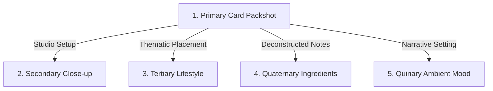

# ARUTALA - Luxury Perfumery (Frontend & Backend Integration Guide)

This documentation serves as a comprehensive guide for building and integrating the **Backend** of the *Arutala* luxury e-commerce application. The frontend is built using React + TypeScript with Tailwind CSS.

---

## 🛠 Current Frontend Tech Stack
* **Framework:** React 19 + TypeScript + Vite
* **Styling:** Tailwind CSS v4
* **Animation:** Motion (Framer Motion)
* **Icons:** Lucide React
* **State Management:** React Context (`CartContext` for shopping cart management)
* **Routing:** Hash-based Custom Router (`window.location.hash`)

---

## 🗄 Required Data Models (Entities)
To replace static mock data in the frontend, the backend database (SQL or NoSQL) must provide the following structures:

### 1. Product (Perfume Product)
Used across the shop, product details, and admin dashboard.
```typescript
interface Product {
  id: string; // or integer (Primary Key)
  slug: string; // unique (e.g., "rintik", "hening")
  name: string; // e.g., "Rintik"
  family: 'Floral' | 'Woody' | 'Citrus';
  subtitle: string;
  description: string;
  price: number;
  images: {
    primary: string; // URL for main packshot
    secondary: string; // URL for close-up macro
    tertiary?: string; // URL for lifestyle product shot
    scent?: string; // URL for ingredients composition
    ambience?: string; // URL for ambient mood scene
  };
  notes: {
    top: string[];
    heart: string[];
    base: string[];
  };
  noteDescriptions: Record<string, string>; // Description of each individual note (JSON/Text)
  volume: string; // e.g., "100ml / 3.4 FL.OZ"
  concentration: string; // e.g., "Extrait de Parfum"
  story: string; // Narrative story of the perfume
  isFeatured?: boolean; // Highlight on landing page
  showInShop?: boolean; // Visibility in shop catalog
  showInCollection?: boolean; // Visibility in collection group
}
```

### 2. Promo (Discount Code / Automatic Discount)
Used in the checkout system and Admin Dashboard.
```typescript
interface QuantityPromo {
  id: string; // Primary Key
  code: string; // Promo code (if empty, discount applies automatically)
  productSlug: string; // Target product slug, or "all" for all products
  productName: string;
  minQuantity: number; // Minimum quantity required to activate promo
  discountType: 'percentage' | 'fixed'; // Percentage (e.g., 15%) or Fixed Amount (e.g., Rp 500,000)
  discountValue: number; 
  description: string;
  isActive: boolean; // Toggle active status
}
```

### 3. Order (Incoming Order)
Saves checkouts from users and renders them on the Admin Dashboard.
```typescript
interface Order {
  id: string; // Order ID (Primary Key)
  date: string; // ISO Datetime string
  customer: {
    name: string;
    email: string;
    address: string;
    city: string;
    postalCode: string;
  };
  items: Array<{
    productSlug: string;
    productName: string;
    productImage: string;
    quantity: number;
    price: number;
  }>;
  total: number; // Total price after discounts and shipping
  status: 'Processing' | 'Shipped' | 'Delivered' | 'Cancelled'; // Shipping status
}
```

### 4. QuizLog (Fragrance Quiz Log)
Records user interactions on the "Fragrance Quiz" feature.
```typescript
interface QuizLog {
  id: string;
  date: string;
  answers: {
    question: string;
    answer: string;
  }[];
  recommendedProductSlug: string;
}
```

### 5. User (Customer & Admin Accounts)
Handles authentication, profile management, and order history.
```typescript
interface User {
  id: string; // Primary Key
  email: string; // Unique email for login
  passwordHash: string; // Hashed password (e.g., bcrypt, argon2)
  name: string;
  role: 'customer' | 'admin'; // Authorization level
  address?: string;
  city?: string;
  postalCode?: string;
  createdAt: string;
}
```

---

## 📡 Planned API Endpoints (RESTful API)

### Auth & Users API (`/api/auth` & `/api/users`)
* `POST /api/auth/register` - Create a new customer account.
* `POST /api/auth/login` - Authenticate user and return a token (JWT/Session).
* `GET /api/auth/me` - Retrieve profile of the currently logged-in user.
* `GET /api/users/orders` - Retrieve order history for the logged-in customer.

### Products API (`/api/products`)
* `GET /api/products` - Retrieve list of all products.
* `GET /api/products/:slug` - Retrieve detailed product by slug.
* `POST /api/products` - (Admin) Create a new product.
* `PUT /api/products/:slug` - (Admin) Update product details.
* `DELETE /api/products/:slug` - (Admin) Delete a product.

### Promos API (`/api/promos`)
* `GET /api/promos` - Retrieve list of active promos.
* `POST /api/promos/validate` - Validate specific promo code applied in cart.
* `POST / PUT / DELETE /api/promos` - (Admin) CRUD operations for Promos.

### Orders API (`/api/orders`)
* `POST /api/orders` - Process checkout. Accepts customer information and cart payload, returning an Order ID.
* `GET /api/orders` - (Admin) Retrieve list of all customer orders.
* `PATCH /api/orders/:id/status` - (Admin) Update order status.

---

## 🔌 Frontend Files to Modify During Backend Integration
When integrating the backend, update these static areas in the frontend to make actual API calls:

1. **`arutala-frontend/src/data/products.ts` & `arutala-frontend/src/data/promos.ts`**
   - Replace static arrays with dynamic API fetches (e.g., `fetch('/api/products')`).
   
2. **`arutala-frontend/src/routes/AdminRoute.tsx`**
   - Switch static dashboard state to backend fetch/mutation calls.
   - Guard this route by verifying admin role credentials (JWT / session token).

3. **`arutala-frontend/src/context/cart-context.tsx` & `arutala-frontend/src/components/CartDrawer.tsx`**
   - Redirect checkout alert to a POST request targeting `/api/orders`.
   - Consider calculating discount logic on the backend for tamper-proof pricing.

4. **`arutala-frontend/src/components/FragranceQuiz.tsx`**
   - Send quiz answers payload to `/api/quiz-logs` upon completion.

---

## 📸 AI Image Generation & Prompting Consistency Guide

To maintain a cohesive luxury brand aesthetic, all generated images must look consistent across the product catalog. Use the following guidelines when prompting AI image generators (such as Midjourney, DALL-E, or Stable Diffusion).

### 1. Consistent Prompt Structure
Maintain the same camera, lighting, and environmental configurations across all prompts, swapping only the product name, color codes, bottle shape, and raw ingredients.

**Standard Prompt Template:**
```text
[Image Description], high-end minimalist product photography, [Subject/Bottle Details], printed with the brand name "ARUTALA" and product name "[Name]" in elegant [Font Style]. Resting on [Surface/Pedestal] against [Background Color]. [Lighting Description], sharp clean shadows, ultra-minimalist luxury brand aesthetic, shot on Hasselblad H6D-100c, 100mm lens, f/8, 8k.
```

### 2. The 5-Photo Visual Strategy
Each product requires 5 distinct, highly relevant image types. Here is how to keep them visually connected:



*   **Photo 1: Primary Packshot (Card Face)**
    *   *Goal:* Clean, centered, front-facing bottle shot on a matching geometric base.
    *   *Tip:* Keep the background solid/matte. The lighting should mimic a clean spotlight or moonbeams.
*   **Photo 2: Secondary Close-up**
    *   *Goal:* Show the premium craftsmanship (label text, cap texture, glass reflections).
    *   *Tip:* Use keywords like `extreme close-up macro photography`, `shallow depth of field`, and focus on the typography of `Cormorant Garamond` (serif) or `Inter` (sans-serif).
*   **Photo 3: Tertiary Lifestyle**
    *   *Goal:* Situate the bottle inside its natural, thematic setting (dresser, study table, beach window).
    *   *Tip:* The bottle design and cap must remain identical to Photo 1. Use similar lighting tones.
*   **Photo 4: Quaternary Scent/Ingredients**
    *   *Goal:* A raw, still-life flatlay of the key ingredients to visually represent the scent.
    *   *Tip:* Do not include the bottle here. Focus on the raw textures of spices, petals, and wood. Use keywords like `flatlay composition`, `raw textures`, and `organic elements`.
*   **Photo 5: Quinary Ambient Mood**
    *   *Goal:* Express the poetic story of the fragrance through an landscape or atmosphere.
    *   *Tip:* Use colors and shadows that represent the time of day corresponding to the scent (e.g., dawn for Fajar, midnight for Puspa, golden hour for Senja).

### 3. Maintaining Bottle Consistency (Midjourney Specific)
If you are generating these images using Midjourney, use the following features to keep the bottle design consistent:

*   **Character Reference (`--cref`):**
    After generating a successful Primary Packshot (Photo 1), copy its image URL and use it as a character reference for Photos 2 and 3:
    `[Prompt for Photo 2/3] --cref [Photo 1 URL] --cw 100`
    *Note: `--cw 100` forces Midjourney to closely copy the bottle shape, color, and cap.*
    
*   **Style Reference (`--sref`):**
    To ensure the color tones, lighting style, and camera quality are identical across all 5 photos, use style reference:
    `[Prompt] --sref [Photo 1 URL]`
    
*   **Consistent Aspect Ratio:**
    Ensure all product shots share the same aspect ratio for card grid alignment (typically `--ar 4:5` or `--ar 1:1`).
    
*   **Font Rendering:**
    Explicitly specify the font style in quotes:
    - `"printed with the brand name 'ARUTALA' in elegant Cormorant Garamond serif typography"`
    - `"printed with the brand name 'ARUTALA' in clean Inter sans-serif typography"`
